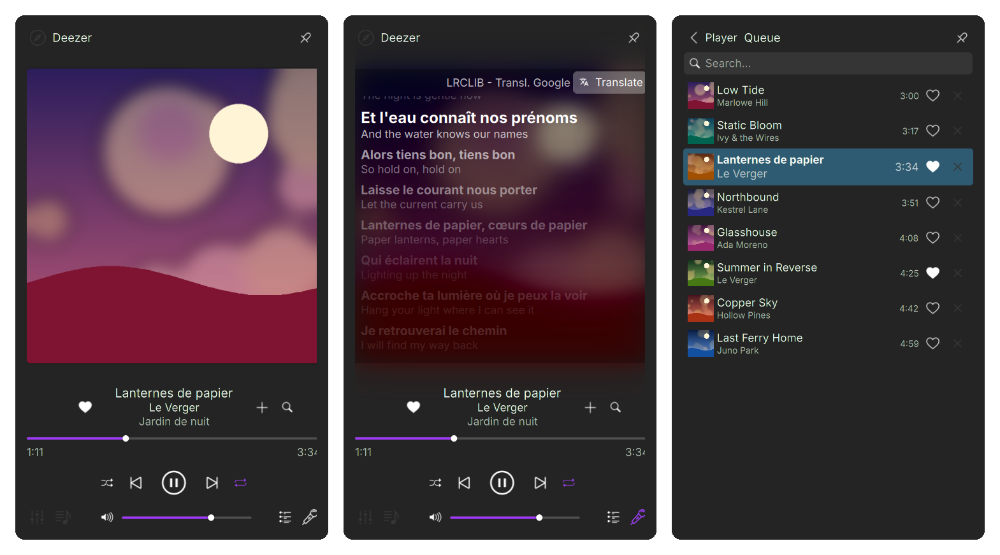

# dzr-plasmoid

An unofficial Plasma 6 panel widget to listen to Deezer with your own account.

Plasma has panel widgets for Spotify, YouTube Music and other music services.
This one is for Deezer: it runs Deezer's official web player in its own
Chromium profile (Qt WebEngine), out of sight, and shows the player, the queue
and the lyrics in native Plasma controls.



The track, covers and lyrics in these screenshots are made up.

> **Not affiliated with Deezer.** This is a personal project. It is not made,
> endorsed or supported by Deezer SA, and has no link with the company.
> "Deezer" is a trademark of Deezer SA; the name only says which service the
> widget works with.

## Why this plasmoid

Deezer has no Linux app: its desktop app exists for Windows and macOS only.
On Linux, what is left is the web player in a browser tab (or installed as a
web app from a Chromium-based browser), and community repackagings of the
Windows app, such as [deezer-linux](https://github.com/aunetx/deezer-linux),
which Deezer does not support. Each of them is a window of its own: to see
what is playing, skip a track or read the lyrics, you first have to find it.

This widget puts Deezer where a music player belongs on a Plasma desktop, in
the panel:

- the music plays without a browser window open;
- a click on the icon shows the player, the queue and the lyrics, with their
  translation when you want it;
- hovering the icon shows the track with its controls, and the mouse wheel
  on it sets the volume;
- in the popup, the usual keys: Space to play or pause, Left and Right to go
  back or forward 5 seconds, with Shift for the previous or next track, Up and
  Down for the volume, M to mute, L for the lyrics and F for the favorites.

It also goes further than the website for lyrics:

- when Deezer has no lyrics for a track, or only its plain text, synced
  lyrics come from [LRCLIB](https://lrclib.net), so many more songs scroll
  with the music;
- when Deezer has no translation, the lyrics can be machine translated line
  by line into your language, with Google or with your own LibreTranslate or
  Ollama server; each translation stays under its line;
- translations are kept on your computer, so a song heard again is
  translated at once, and with Translate on, the next tracks are translated
  as they come;
- the lyrics show over the blurred cover, the sung line highlighted with a
  fade around it, and a click on a line jumps there; where the lyrics or
  their translation do not come from Deezer, the view says so.

It still runs the official website, so Deezer itself plays the music.

## What it is

The widget is a small web browser. It opens the regular Deezer website,
https://www.deezer.com, in an embedded Chromium view (QtWebEngine), where you
sign in with your own Deezer account. The website plays the music, as it
would in a browser tab, under your subscription and with its own protection
of the streams. The popup shows what that page offers (cover, title, queue,
lyrics) in native Plasma controls, and presses the page's buttons for you.

What it does not do:

- It does not download, record or convert music, and does not touch the
  protection of the streams.
- It contains no code or content from Deezer. Covers and lyrics are fetched
  by the page for your session and are not kept on disk; only the optional
  machine translations of lyrics are, on your computer.
- It does not give access to anything your Deezer plan does not include.

Using it, you remain bound by Deezer's Terms of Use, which allow personal,
private use only. The widget relies on the website's internal interfaces,
which are not a public API: Deezer may change them at any time, and the
widget may then stop working. Should Deezer ask for it, this project will be
taken down.

Lyrics come from Deezer (licensed by LyricFind) or, when Deezer has none or
no synced version, from LRCLIB, whose lyrics are contributed by its users.
An option, off by default, also asks lrcmux, which gathers lyrics from
unofficial and unlicensed sources (YouTube Music, KuGou, Musixmatch and
others); it is meant for personal use and may stop working at any time.
Machine translation is optional: it sends the lyrics to the engine chosen in
the settings (Google, or your own LibreTranslate or Ollama server). Deezer's
own lyrics go to Google only if you allow it in the settings. The Google
engine is the free endpoint of Google Translate's web widget
(`client=gtx`), not Google's paid Cloud Translation API.

The panel icon is the widget's own. The settings can show deezer.com's
favicon instead, as the page loads it, the way a browser shows it in a tab:
no Deezer image is shipped. The Deezer logo is a trademark of Deezer SA.

This software is provided as is, without any warranty.

## How it works

The Deezer page runs hidden inside the widget and plays the audio; the popup
shows a native player fed by polling the page. The widget drives the page
through `window.dzPlayer` and the site's own calls, none of which is a public
Deezer API. All page-side scripts live in `package/contents/code/page.js`.

## Run for development

```sh
cd package
QTWEBENGINE_REMOTE_DEBUGGING=127.0.0.1:9333 plasmoidviewer -a . -f horizontal -l topedge
```

Open http://127.0.0.1:9333 in Chromium to get DevTools on the hidden page.
`tools/cdp_eval.py` evaluates an expression read from stdin in that page.

## Install

The widget needs the QML module of Qt WebEngine, which many distributions do
not install with Plasma. Without it, the widget only shows an error.

- Debian, Ubuntu, KDE neon: `qml6-module-qtwebengine`
- Fedora: `qt6-qtwebengine`
- Arch Linux: `qt6-webengine`

Then install the `.plasmoid` file of the latest release
(https://github.com/rcspam/dzr-plasmoid/releases):

```sh
kpackagetool6 -t Plasma/Applet -i dzr-plasmoid-0.2.0.plasmoid   # first time
kpackagetool6 -t Plasma/Applet -u dzr-plasmoid-0.2.0.plasmoid   # update
```

Or from a clone of this repository:

```sh
kpackagetool6 -t Plasma/Applet -i package/   # first time
kpackagetool6 -t Plasma/Applet -u package/   # update
```

Then add "DZR" to a panel.

Sign in once through the Deezer page button at the top of the popup. The
session is stored in the `deezer-plasmoid` QtWebEngine profile of the host
process.

## Translations

`tools/i18n.sh` extracts the `i18n()` strings into `po/template.pot`, merges
them into each `po/<lang>.po` and compiles the `.mo` files into
`package/contents/locale`. Plasma only loads them from an installed package,
not when `plasmoidviewer` runs the source folder.

## Settings

General: the Deezer site language (the system's by default, English when
Deezer does not have it) and the panel icon, that is the widget's own, the
Deezer site's icon or any icon you pick, and its wheel. Lyrics: how they look,
over the blurred cover with a text color to suit it, or black on white, or
white on black, with the cover blur, text size and fade. Non-Deezer
services: everything sent elsewhere than Deezer, that is the lyrics sources
(LRCLIB, and the extended sources through lrcmux, off by default), the
translation engine (Google, a LibreTranslate or an Ollama server with an
editable prompt, or none), whether Deezer's own lyrics may also go to
Google (off by default; your own server always gets them), and the
translation cache. Storage: the web engine's HTTP cache, its limit and a
button to empty it.

## License

Copyright 2026 rcspam. This program is free software, under the GNU General
Public License, version 3 or (at your option) any later version; see
[LICENSE](LICENSE).

Not covered by it: the karaoke microphone icons, which are "Karaoke Sing"
from SVG Repo (https://www.svgrepo.com/svg/190626/karaoke-sing), recoloured,
under the Creative Commons license stated on that page. The widget icon and
the purple shuffle and repeat icons are Breeze icons (KDE), under the GNU
Lesser General Public License, version 3 or later.
